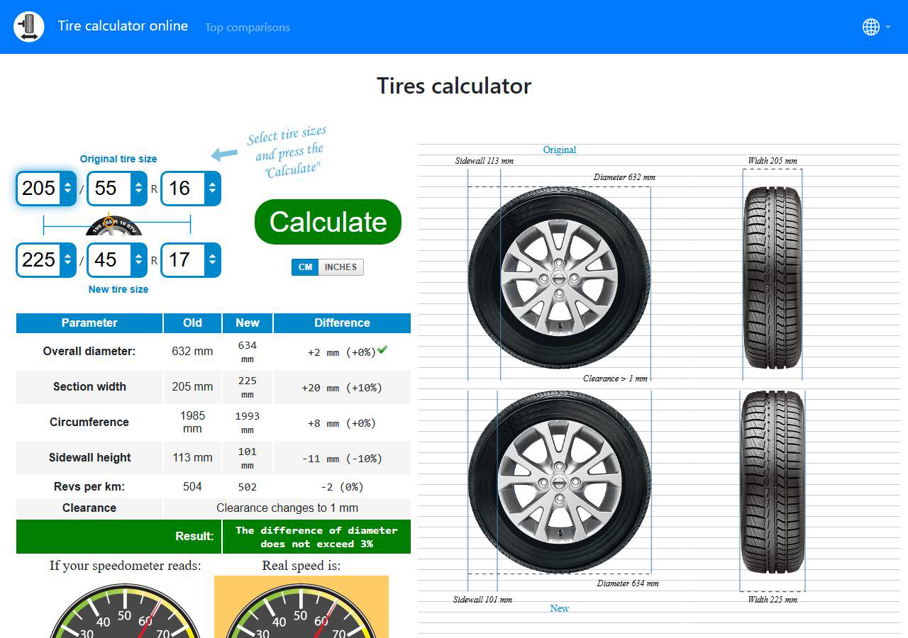

# Calculator checkbook

Keep the input you tried, the answer you expected and the output you saw. This small CSV checker compares recorded observations; it does not calculate the expected answers for you.

Numeric rows have an explicit absolute tolerance. Text rows compare the exact output, which is useful for date labels and thousands separators. The helper scripts are MIT licensed, require Node 18 or later and have no package dependencies.

```bash
npm test
npm run check
npm run table
node scripts/checkbook.js my-checks.csv
```

The supplied example is an illustrative template, not a claim that every listed calculator was independently certified:

```text
6 observations: 6 match, 0 differ.
```

The CSV header is `case,kind,expected,observed,tolerance,note`. Use `number` with a nonnegative decimal tolerance, or `text` with an empty tolerance. Blank observations, repeated identifiers and non-finite numbers are rejected. Quote fields containing commas. A mismatch exits with code 1; invalid input exits with code 2.

Default output is a summary and at most three mismatches. Add `--verbose` for all mismatches, or `--markdown` for the full table.

## Why keep the displayed value?

A display may round a nominal tire diameter of 634.3 mm to 634 mm. The example row accepts half a millimetre of absolute display rounding. Choose a tolerance appropriate to your own task; this one is not a tire-fitment rule.



## Browser calculators to try

We maintain the linked tools. Try it here: pick the calculator that matches your task, record an observation, then compare it with a reference result you obtained independently.

| Task | Calculator | Note |
|---|---|---|
| Tire dimensions | [Tire size comparison](https://tire-calc.com/) | Compare nominal diameter and circumference; vehicle approval is a separate question. |
| Scientific expressions | [Scientific calculator](https://toolster.net/scientific_calculator) | Record the angle mode along with the expression. |
| Height and weight | [BMI calculator](https://toolster.net/bmi_calculator) | Keep the unit system with the input; the notebook provides no health interpretation. |
| Plotting | [Graphing calculator](https://toolster.net/graphing_calculator) | Keep the expression and plotted range in your note. |
| Fractions | [Fractions calculator](https://toolster.net/fractions_calculator) | Use exact text when mixed-number formatting matters. |
| Dates | [Date calculator](https://toolster.net/years_calc) | Record whether the endpoints are included. |
| Basic operations | [Basic calculator](https://toolster.net/basic_calculator) | Keep the key sequence, not just the final number. |
| Tire-size entry point | [Tire size calculator](https://toolster.net/tire_size_calculator) | Redirects to Tire Calc; it is the same destination, not another calculator. |
| Simple arithmetic | [Simple calculator](https://toolster.net/simple_calculator) | A place to record a short repeatable calculation. |
| Number formatting | [Comma calculator](https://toolster.net/comma_calculator) | Use text comparisons to preserve separators. |

The screenshot is our live Tire Calc run. The [tire-comparison article](https://webtoolmanuals.wordpress.com/2026/11/02/tire-size-comparison-check-diameter-and-speedometer-change-before-buying/) explains the rounded display and the separate fitment checks. Video tutorial: [online calculator overview](https://youtu.be/ANq-zdh3A4g).

The site source code is not included. This repository contains only the independent notebook helper and its example data.
